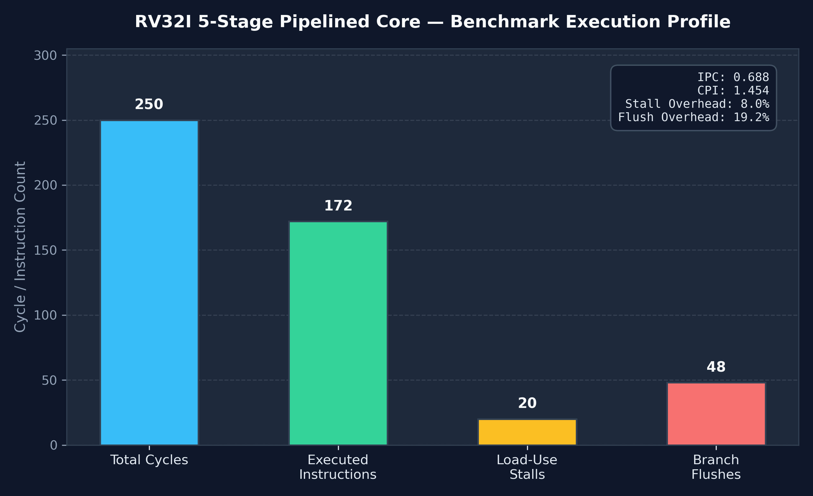

# 5-Stage Pipelined RV32I RISC-V Processor

[](https://en.wikipedia.org/wiki/Verilog)
[](http://iverilog.icarus.com/)
[](https://www.cocotb.org/)
[](https://riscv.org/)
[](LICENSE)

A synthesizable 32-bit **RV32I RISC-V 5-stage pipelined processor** implemented in Verilog and verified with Python-based testbenches using **Cocotb** and **Icarus Verilog**. Features a complete Hazard Unit (RAW data forwarding, load-use stall insertion, branch flushing), automated benchmarking, and visual performance profiling.

---

## Architecture Overview

The core follows the classic RISC 5-stage pipeline architecture with balanced stage delays:

```
    +---------------------------------------------------------------------------------+
    |                                 HAZARD UNIT                                     |
    |   - Forwarding: EX-to-EX & MEM-to-EX ForwardAE / ForwardBE                      |
    |   - Load-Use Detection: StallF, StallD, FlushE                                  |
    |   - Branch Resolution: FlushD, FlushE                                           |
    +--------+---------------+--------------------+------------------+----------------+
             |               |                    |                  |
+------------v---+     +-----v----------+   +-----v----------+   +---v------------+   +----------------+
|  STAGE 1: IF   |     |  STAGE 2: ID   |   |  STAGE 3: EX   |   |  STAGE 4: MEM  |   |  STAGE 5: WB   |
|                |     |                |   |                |   |                |   |                |
|  - PC Register | ==> |  - ControlUnit |==>|  - 32-bit ALU  |==>|  - Data Memory |==>|  - Writeback   |
|  - Instr Mem   |     |  - RegFile     |   |  - Forward MUX |   |  - MemWrite    |   |  - Result MUX  |
|  - PC + 4      |     |  - Imm Extend  |   |  - Branch Calc |   |                |   |  - RegWrite    |
+----------------+     +----------------+   +----------------+   +----------------+   +----------------+
       [IF/ID Reg]         [ID/EX Reg]          [EX/MEM Reg]         [MEM/WB Reg]
```

### Pipeline Stages
1. **Instruction Fetch (IF)**: Fetches 32-bit instructions from Instruction Memory at current `PC`, computes `PC + 4`, and manages `PC` updates with stall protection.
2. **Instruction Decode (ID)**: Decodes instruction opcode, generates control signals via `control_unit`, reads operands from the 32-register Register File, and performs sign-extension of 32-bit immediates.
3. **Execute (EX)**: Performs arithmetic/logic operations via the 32-bit `alu`, resolves data forwarding paths, calculates branch target addresses, and evaluates branch outcomes.
4. **Memory Access (MEM)**: Interfaces with synchronous Data Memory (`dmem`) for 32-bit load (`lw`) and store (`sw`) operations.
5. **Writeback (WB)**: Selects the final result between ALU calculation, memory read data, and `PC + 4` (for `jal`), writing back into the destination register `rd`.

---

## Features

- **Standard RV32I Base Integer ISA Support**:
  - **R-type**: `add`, `sub`, `and`, `or`, `xor`, `sll`, `srl`, `sra`, `slt`, `sltu`
  - **I-type**: `addi`, `andi`, `ori`, `xori`, `slli`, `srli`, `srai`, `slti`, `sltiu`, `lw`
  - **S-type**: `sw`
  - **B-type**: `beq` (branch equal test with branch target calculation)
  - **J-type**: `jal` (unconditional jump with return address link)
  - **U-type**: `lui` (load upper immediate)
- **Advanced Hazard Resolution**:
  - **Data Forwarding (Bypassing)**: 3-way multiplexers (`ForwardAE`, `ForwardBE`) forward most recent results from MEM and WB stages directly to EX stage ALU inputs, resolving consecutive Read-After-Write (RAW) data hazards with zero stall penalty.
  - **Load-Use Hazard Stalling**: Detects dependent instructions immediately following a `lw` instruction, stalling the IF and ID stages (`StallF = 1`, `StallD = 1`) and injecting a single-cycle bubble into EX (`FlushE = 1`).
  - **Control Hazard Branch Flushing**: Clears mispredicted instructions in the decode and execute stages (`FlushD = 1`, `FlushE = 1`) upon a taken branch or jump, resuming execution at `PCTargetE`.
  - **Register File Write-Through Forwarding**: Internal write-to-read bypass ensures simultaneous writes in WB and reads in ID in the same cycle provide fresh data.
- **Reference Single-Cycle Datapath**:
  - Includes a standalone, fully verified single-cycle processor model (`riscv_single_cycle.v`) for behavioral validation and differential testing.
- **Synthesis-Ready**:
  - Standard `` `timescale 1ns / 1ps `` directives, strict avoidance of unwanted memory latches, and fully synthesizable in **Xilinx Vivado**.

---

## Tech Stack

| Domain | Technology / Tool | Version | Description |
| :--- | :--- | :--- | :--- |
| **HDL** | Verilog / SystemVerilog | IEEE 1364-2005 / 1800-2012 | Synthesizable RTL design |
| **Synthesis** | Xilinx Vivado | 2022.1+ / 2026.x | Target FPGA synthesis & implementation |
| **Simulation** | Icarus Verilog (`iverilog`) | 11.0+ | Fast open-source IEEE-compliant simulator |
| **Verification** | Cocotb | 2.1.0+ | Modern coroutine-driven Python testbench framework |
| **Waveforms** | GTKWave | 3.3.104+ | Interactive FST/VCD digital waveform analysis |
| **Modeling & Analytics** | Python, NumPy, Pandas, Matplotlib | 3.10+ | Golden reference models & automated performance visualizer |

---

## Directory Structure

```
.
├── rtl/                          # Synthesizable Verilog RTL source files
│   ├── alu.v                     # 32-bit combinational Arithmetic Logic Unit
│   ├── control_unit.v            # Main decoder and ALU decoder logic
│   ├── extend.v                  # Immediate generator (I, S, B, J, U formats)
│   ├── hazard_unit.v             # Pipeline forwarding, stalling, and flush unit
│   ├── memories.v                # Instruction and Data RAM models
│   ├── pipeline_regs.v           # IF/ID, ID/EX, EX/MEM, MEM/WB pipeline registers
│   ├── regfile.v                 # 32x32-bit register file with write-through bypass
│   ├── riscv_pipeline.v          # Top-level 5-stage pipelined processor
│   └── riscv_single_cycle.v      # Reference single-cycle processor
├── programs/                     # Precompiled test binaries and memory images
│   └── inst_mem.mem              # Hex memory image loaded via $readmemh
├── sim/                          # Cocotb verification testbenches & Makefile
│   ├── Makefile                  # Automated test runner and simulator configuration
│   ├── test_alu.py               # Boundary and randomized testbench for ALU
│   ├── test_regfile.py           # Register file read/write and x0 immutability tests
│   ├── test_single_cycle.py      # End-to-end single-cycle execution verification
│   ├── test_pipeline_basic.py    # 5-stage structural latency & datapath test
│   ├── test_pipeline_hazards.py  # RAW forwarding, load-use stall, & branch flush verification
│   └── test_pipeline_perf.py     # 250-cycle benchmark profiling & CSV export
├── scripts/                      # Modeling and analysis automation scripts
│   ├── golden_model.py           # Python bit-accurate reference model for ALU & RV32I
│   └── perf_visualizer.py        # Generates performance bar charts from CSV metrics
├── results/                      # Simulation artifacts, metrics, and figures
│   ├── pipeline_stats.csv        # Exported execution statistics (Cycles, Stalls, IPC)
│   └── performance_graph.png     # Rendered high-resolution benchmark visualization
└── README.md                     # Project documentation
```

---

## Getting Started

### Prerequisites

On Ubuntu/Debian systems, install the required simulation tools and Python packages:

```bash
# 1. Install simulation tools
sudo apt-get update
sudo apt-get install -y iverilog gtkwave python3 python3-pip

# 2. Install Python verification and plotting dependencies
pip install cocotb cocotb-bus "numpy<2" pandas matplotlib
```

---

## Running Verification Testbenches

All testbenches are executed through the unified `sim/Makefile` using Cocotb and Icarus Verilog:

```bash
cd sim
```

### 1. Unit Tests
- **Test Arithmetic Logic Unit (ALU)**:
  ```bash
  make test_alu
  ```
- **Test Register File (`regfile`)**:
  ```bash
  make test_regfile
  ```

### 2. Integration Tests
- **Test Single-Cycle Processor**:
  ```bash
  make test_single_cycle
  ```
- **Test 5-Stage Pipeline Structural Functionality**:
  ```bash
  make test_pipeline_basic
  ```

### 3. Hazard Resolution Verification
Runs comprehensive test sequences covering RAW forwarding, 1-cycle load-use stalls, and branch target flushes:
```bash
make test_pipeline_hazards
```

### 4. Run Complete Regression Suite
```bash
make test_all
```

---

## Performance Benchmarking & Profiling

### Running the Benchmark
The performance benchmark executes an iterative array compute loop (250 clock cycles) exercising consecutive data hazards, memory load-use dependencies, and branch loops:

```bash
cd sim
make test_pipeline_perf
```

This generates `results/pipeline_stats.csv` recording:
- **Total Cycles**: Overall elapsed clock cycles.
- **Executed Instructions**: Total non-flushed instructions retired through the EX stage.
- **Stalls**: Number of cycles delayed by `StallD` due to load-use dependencies.
- **Flushes**: Number of cycles flushed by `FlushE` due to load-use bubbles and branch taken events.
- **IPC / CPI**: Instructions Per Cycle ($IPC = \frac{Instructions}{Cycles}$) and Cycles Per Instruction.

### Generating Performance Visualization
Run the visualization script from the repository root:

```bash
python3 scripts/perf_visualizer.py
```

This reads `results/pipeline_stats.csv` and outputs `results/performance_graph.png`:



### Benchmark Summary

| Metric | Measured Value | Description |
| :--- | :---: | :--- |
| **Total Clock Cycles** | **250** | Total simulation cycles elapsed |
| **Executed Instructions** | **172** | Successfully executed instructions |
| **Load-Use Stalls** | **20** | 1-cycle pipeline delays (StallD) |
| **Branch Flushes** | **48** | Control hazard penalty cycles (FlushE) |
| **IPC (Instructions Per Cycle)** | **0.688** | Sustained execution throughput |
| **CPI (Cycles Per Instruction)** | **1.454** | Average cycles per retired instruction |

---

## Waveform Analysis

To view digital waveforms in GTKWave with FST signal tracing:

```bash
cd sim
make waves_pipeline_perf
```

Key signals to inspect:
- `dut.PCF`, `dut.PCE`: Program counters in Fetch and Execute stages.
- `dut.ForwardAE`, `dut.ForwardBE`: Active operand forwarding channels (`2'b10` = MEM, `2'b01` = WB).
- `dut.u_hazard.StallF`, `dut.u_hazard.StallD`: Hardware stall lines.
- `dut.u_hazard.FlushD`, `dut.u_hazard.FlushE`: Hardware flush control lines.
- `dut.PCSrcE`, `dut.PCTargetE`: Branch decision and calculated target address.

---

## Author & Acknowledgements
- Developed as part of the RV32I 5-Stage Pipelined RISC-V Processor Project.
- Architecture referenced from *Computer Organization and Design: The Hardware/Software Interface (RISC-V Edition)* by David A. Patterson and John L. Hennessy.
